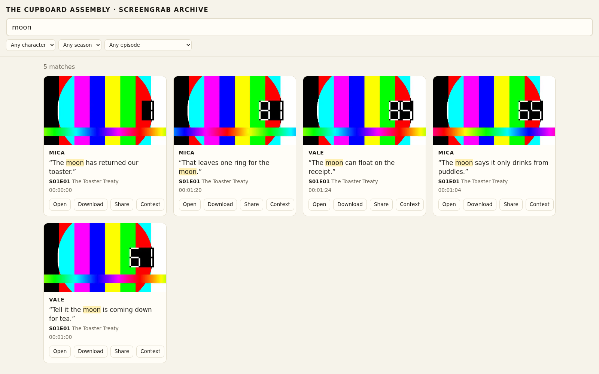

# Screengrab Archive

Type a line of dialogue to find the quote, speaker when available, episode, timestamp, and a screengrab from your own local copy of a show. Screengrab Archive is a self-hosted, show-agnostic take on Frinkiac. It builds the search index and extracts frames on your machine.

[Frinkiac](https://frinkiac.com/) made dialogue-to-frame search familiar for *The Simpsons*, and [Morbotron](https://morbotron.com/) did the same for *Futurama*. Both inspired the search experience. Screengrab Archive is an engine you run against your own media and can export as a browser-searchable static site.

## Try the demo

From the checkout, run:

```sh
python -m http.server 8080 --bind 127.0.0.1 --directory docs
```

Open [the demo with a search for “moon”](http://127.0.0.1:8080/?q=moon). The result cards show a frame from the moving test pattern captured at each line's midpoint, alongside dialogue by Mica and Vale, the episode title, and the timestamp. Open a card to see neighboring lines.



The demo contains one silent synthetic episode, *The Toaster Treaty*, with 24 original subtitle lines and 24 generated WebP frames. See [how to rebuild it](docs/PUBLISHING.md#rebuild-the-demo).

## Quick start with your media

Requires Python 3.10+ with SQLite FTS5 and [FFmpeg](https://ffmpeg.org/download.html) with both `ffmpeg` and `ffprobe` on PATH. From the checkout, activate a virtual environment and run:

```sh
python -m pip install -r requirements.txt
python -m archive inspect-media ./media
python -m archive process-all ./media --whisper never
python -m archive serve
```

Put files such as `S01E01.mkv` and matching sidecars such as `S01E01.srt` in `media/`. Open the [local search UI](http://127.0.0.1:8000/) after processing. Try a phrase in quotes or combine terms with filters such as `speaker:MICA episode:S01E01`.

The pipeline uses embedded text subtitles, matching SRT/VTT sidecars, or optional local Whisper transcription. Speaker labels come from subtitle prefixes or a local transcript aligned to the timing cues. Files with episode codes can generate `episodes.json` automatically. To supply titles, use filenames without codes, or keep multiple shows separate, follow the [processing runbook](docs/RUNBOOK.md).

## Publish a static site

```sh
python -m archive export-static --out site --copy-images
python -m http.server 8080 --bind 127.0.0.1 --directory site
```

The browser searches the exported dialogue JSON directly. You can serve the output on any static host, including GitHub Pages, for material you have permission to share. The export includes the searchable dialogue and, with `--copy-images`, the primary frames. See the [publishing guide](docs/PUBLISHING.md) for hosting and optional share previews.

## Rights, license, and credits

You need the rights to process your media and separate permission as applicable to publish dialogue or screengrabs. The project ships no third-party copyrighted show content. Imported transcripts, subtitles, and video stay local during processing. Publishing is an explicit step that exposes the search text and any hosted frames.

Code is available under the [MIT license](LICENSE). The original demo dialogue and synthetic frames may be reused under the same terms. Thanks to the original archive contributors and to the creators of Frinkiac and Morbotron.

Run the test suite with `python -m pytest`. FFmpeg and Node.js enable the frame-extraction and JavaScript search parity tests.
